# FuturesDesk — Quantitative Market Intelligence & Risk Analytics

A quantitative decision-support, market intelligence, and futures risk analytics platform designed for systematic research, cross-asset derivatives analysis, and disciplined risk evaluation.

> **Project Status:** Active Quantitative Research Platform. Core market-microstructure engineering, live multi-arm experimentation, execution-realism analytics, and statistical validation frameworks are fully **`[Implemented]`**. Multi-asset futures intelligence, commodity curve analytics, portfolio risk modeling, and AI research support are currently **`[Planned]`** on the development roadmap. All trading analytics described in this repository are simulated with zero live capital deployed. See [Disclaimer](#disclaimer).

---

## 1. Project Overview

### The Problem
Derivatives and commodity futures trading require synthesizing disparate, high-dimensional market information: high-frequency order books, term-structure dynamics (contango and backwardation), non-linear basis shifts, macroeconomic indicators, and physical supply-demand reports (EIA, CFTC COT, USDA).

In practice, quantitative researchers and trading analysts frequently face three critical failure modes:
1. **Execution and Fill Illusions:** Backtested strategies that assume passive spread capture or frictionless fills fail in live markets due to adverse selection, order queue dynamics, and aggressive transaction friction (exchange turnover fees, taxes, and clearing charges).
2. **Backtest Overfitting & Selection Bias:** Racing multiple strategy variations across historical datasets inevitably surfaces spurious alpha if multiple-testing adjustments (e.g., Deflated Sharpe Ratio, Probability of Backtest Overfitting) are omitted.
3. **Fragmented Analytics & Tail-Risk Blind Spots:** Market data feeds, fundamental reports, and risk engines are often siloed, making coherent cross-asset surveillance, scenario stress testing, and tail-risk measurement (VaR / Expected Shortfall) cumbersome and slow.

### The Solution: FuturesDesk
**FuturesDesk** is designed as a unified quantitative decision-support and market research platform that bridges low-latency market microstructure, systematic statistical research, and institutional-grade portfolio risk analytics. Aligned with the operational rigor of proprietary derivatives trading desks (such as Futures First), FuturesDesk emphasizes:

- **Data-Driven Market Intelligence:** Systematic cross-asset surveillance tracking energy, metals, agriculture, equity index, and interest rate futures.
- **Execution Realism:** Rigorous empirical evaluation decomposing simulated spread capture from true directional edge, accounting for order queue priority and transaction cost structures.
- **Statistical Integrity:** Enforcing strict statistical gauntlets—effective sample size adjustments ($n_{\text{eff}}$), Deflated Sharpe Ratios (DSR), and Combinatorially Symmetric Cross-Validation (CSCV)—to eliminate curve-fitting.
- **Multi-Horizon Risk Management:** Dynamic position sizing, contract multiplier accounting, Value at Risk (VaR), Expected Shortfall (CVaR), and macroeconomic crisis stress testing.

---

## 2. Current Implementation `[Implemented]`

The repository contains an end-to-end, working quantitative research and paper-trading platform engineered for high-frequency equity futures. Every item in this section is fully implemented and verifiable within the codebase.

```
FuturesDesk Codebase Architecture (Implemented)
├── paper_trader/          # Live multi-arm execution harness & simulated broker
│   ├── feed_client.py     # Asyncio WebSocket client for live exchange data
│   ├── dhan_parser.py     # Binary parser for 20-level market depth packets
│   ├── harness.py         # Multi-arm race coordinator running on a single shared feed
│   ├── broker.py          # Simulated broker with realistic friction, margin, & latency
│   └── monitor/           # Stdlib HTTP telemetry server and Canvas dashboard
├── basecamp_recon/        # Execution-realism & statistical gauntlet engine
│   ├── markout.py         # Per-fill markout analysis & mid-to-mid price decomposition
│   ├── fill_sim.py        # Queue-aware fill simulation & spread-retention model
│   ├── arm_stats.py       # Econometric engine: n_eff, PSR, DSR, PBO, block bootstrap
│   └── kalman.py          # State-space Kalman velocity & regime estimators
├── alpha_lab/             # Isolated research workspace for post-maker model alphas
│   ├── stats.py           # Self-contained statistical validation gauntlet
│   └── data/              # Historical 1m and daily data ingestion pipelines
├── research/              # Quantitative signal library & backtesting models
│   ├── backtester/        # Custom event-driven & vectorized backtesting engines
│   ├── features/          # Microstructure feature library (OFI, microprice, depth)
│   └── pairs_ou/          # Cointegration (Johansen/ADF) & Ornstein-Uhlenbeck models
├── report/                # Formal research documentation & publication figures
│   ├── report.tex         # Complete academic/industry technical report
│   ├── report.pdf         # Compiled publication-grade PDF report
│   └── make_figures.py    # Vector dataviz generation scripts
└── tests/                 # Comprehensive Pytest test suite (brokers, engines, harnesses)
```

### High-Frequency Data Pipeline & Depth Ingestion
- **20-Level Depth Ingestion:** A high-throughput WebSocket client (`paper_trader/feed_client.py`) connecting to live exchange feeds (NSE via Dhan), parsing binary packets (`paper_trader/dhan_parser.py`) for 20-level bids, asks, and order counts at sub-second frequencies.
- **Partitioned Time-Series Storage:** High-efficiency Parquet serialization capturing full tick-by-tick order depth, exchange timestamps, receive timestamps, and packet latency.
- **Microstructure Feature Engine:** Feature engineering library (`research/features/`) computing Order Flow Imbalance (OFI), microprice estimation, bid-ask spreads, depth liquidity ratios, and trade classification.

### Head-to-Head Multi-Arm Experimentation Harness
Because compacted historical replays can mask intraday divergence, strategy variants are raced live, head-to-head, on a single shared market data feed (`paper_trader/harness.py`).
- **Concurrent Strategy Arms:** Evaluated variants include `control` (baseline maker), `wide_stop` (24-tick stop threshold), `no_stop`, `selective` (high edge margin threshold), `expanded` (multi-instrument universe), `no_icici`, and `reversal` exit.
- **Institutional Cost Modeling:** Simulated broker (`paper_trader/broker.py`) enforces exchange turnover charges, clearing fees, regulatory turnover fees, STT, GST, and stamp duty.
- **Risk Governor:** Real-time circuit breaker tripwires (e.g., automated shutdown at -₹20,000 intraday drawdown) and position margin verification.

### Execution Realism: The Headline Empirical Finding
The platform conducted an extensive paper-trading run and subsequent execution-realism analysis (`basecamp_recon/markout.py`, `fill_sim.py`). A naive touch-fill simulation indicated strong profitability. However, a mid-to-mid decomposition proved that this apparent profitability was an artifact of optimistic spread-capture assumptions:

| Performance Metric | Simulated Value | Marked to Mid | Economic Significance |
|---|---|---|---|
| **Net P&L** | **+₹238,000** | **-₹1,014,000** | Optimistic touch fills masked a severe negative directional drift |
| **Spread Capture** | **+₹1,252,000** | **₹0** | The bid/ask edge the simulator assumed it captured on both legs |
| **Win Rate** | **77.0%** | **12.6%** | "Wins" were driven by the fill assumption, not market timing |
| **Directional Alpha** | Positive (apparent) | **Negative** | The strategy systematically traded into adverse selection |

**Key Microstructure Insights:**
1. **Break-Even Spread Retention:** Break-even required retaining $\ge 81\%$ of the theoretical bid-ask spread. Queue-position simulation revealed that non-colocated retail execution retains significantly less.
2. **Fill-Rate Sensitivity:** Data-derived break-even fill rate was $p^* = 67.2\%$. The simulation ran at $75.9\%$, leaving only an 8.7 percentage point cushion against adverse selection.
3. **Transaction Fee Drag:** Transaction taxes and exchange fees accounted for ~two-thirds of round-trip costs, making high-turnover, single-tick spread capture unviable without institutional rebates.
4. **Research Outcome:** Proved on paper—with zero capital at risk—that retail latency (~15 ms) cannot compete in high-frequency market-making, motivating the pivot to taker-side statistical models (statistical arbitrage, Ornstein-Uhlenbeck mean-reversion, factor models) documented in [`ALPHA_CATALOG.md`](ALPHA_CATALOG.md).

### Statistical Gauntlet & Overfitting-Aware Evaluation
To prevent data-snooping bias, the platform implements an econometric validation engine (`basecamp_recon/arm_stats.py`, `alpha_lab/stats.py`):
- **Effective Sample Size ($n_{\text{eff}}$):** Adjusts raw trade counts for serial return autocorrelation.
- **Probabilistic Sharpe Ratio (PSR):** Accounts for skewness and fat-tailed kurtosis in returns.
- **Deflated Sharpe Ratio (DSR):** Deflates the observed Sharpe ratio based on the number of trials ($N$) and variance of tested variants (Bailey & López de Prado).
- **Probability of Backtest Overfitting (PBO):** Combinatorially Symmetric Cross-Validation (CSCV, 20 splits) evaluating out-of-sample rank stability.
- **Stationary Block Bootstrap:** Computes rigorous 95% confidence intervals on daily Sharpe ratios and paired arm differences.
- **Promotion Gate:** Enforces hard qualification hurdles (DSR $\ge 0.95$, PBO $\le 0.20$). In testing, the top arm (`expanded`) achieved DSR = 0.93 with PBO = 0.00; rather than promoting an unproven model, the platform upheld the gate until sufficient sample size could be collected.

### Regime Attribution & Mathematical Modeling
- **Kalman Filter Velocity:** State-space constant-velocity filter on log-price (`basecamp_recon/kalman.py`) isolating underlying trend momentum from microstructure noise.
- **Regime Identification:** Variance ratio and Hurst exponent estimators categorizing sessions into orderly trends, gentle mean-reversion, or hostile whipsaw regimes.
- **Statistical Arbitrage Modeling:** Engle-Granger and Johansen cointegration testing paired with Ornstein-Uhlenbeck (OU) stochastic spread modeling (`research/pairs_ou/`).

### Telemetry & Research Infrastructure
- **Live Monitor Console:** Zero-dependency Python standard library HTTP server (`paper_trader/monitor/serve_monitor.py`) serving an HTML5/Canvas dashboard displaying real-time arm leaderboards, cumulative equity curves, drawdown gauges, and open positions.
- **Academic Research Report:** Fully reproducible LaTeX technical document (`report/report.tex`, `report/report.pdf`) with automated vector chart generation (`report/make_figures.py`).
- **Pytest Suite:** Test suite across brokers, monitors, backtesters, feature engines, and harnesses (`tests/`).

### Existing Repository Guide

| Path | Description |
|---|---|
| [`ALPHA_CATALOG.md`](ALPHA_CATALOG.md) | Quantitative alpha catalog: model specifications, edge theses, and asset decisions |
| [`SEAT_AND_STRATEGIES.md`](SEAT_AND_STRATEGIES.md) | Trading seat analysis: institutional vs retail latency constraints and edge accessibility |
| [`BASECAMP_RECON.md`](BASECAMP_RECON.md) | Overfitting-disciplined research methodology (DSR, PBO, $n_{\text{eff}}$, regime attribution) |
| [`basecamp_recon/`](basecamp_recon/) | Analysis engine: econometric statistics, markout decomposition, and Kalman filtering |
| [`alpha_lab/`](alpha_lab/) | Dedicated research workspace: historical data pipelines and statistical validation gauntlet |
| [`paper_trader/`](paper_trader/) | Multi-arm live paper-trading harness, broker simulation, and telemetry dashboard |
| [`research/`](research/) | Feature library, backtesting engine, and Ornstein-Uhlenbeck cointegration models |
| [`report/`](report/) | Technical publication report (`report.pdf`), LaTeX source, and figure generators |
| [`tests/`](tests/) | Unit and integration test suite for trading engine, harness, and risk components |

---

## 3. Planned Features / Roadmap

Building on the existing microstructure and statistical infrastructure, FuturesDesk is expanding into a comprehensive **Global Commodity Futures Intelligence & Risk Analytics Platform**, aligned with institutional derivatives trading requirements.

```
Roadmap Overview
├── Phase 1: Market Intelligence           [Planned]
├── Phase 2: Quantitative Research         [Planned]
├── Phase 3: Portfolio Risk Analytics      [Planned]
└── Phase 4: AI Research Assistant         [Future Scope]
```

### Phase 1 — Market Intelligence `[Planned]`
*Objective: Deliver real-time, multi-timeframe market surveillance across global commodity, interest rate, and equity futures.*

- **Multi-Asset Futures Surveillance:**
  - **Energy:** WTI Crude Oil (`CL`), Brent Crude Oil (`BZ`), Natural Gas (`NG`).
  - **Metals:** Gold (`GC`), Silver (`SI`), High-Grade Copper (`HG`).
  - **Agriculture:** Corn (`ZC`), Wheat (`ZW`), Soybeans (`ZS`).
  - **Equity Indices:** E-mini S&P 500 (`ES`), E-mini Nasdaq 100 (`NQ`).
  - **Fixed Income / Rates:** 10-Year US Treasury Note (`ZN`), 30-Year US Treasury Bond (`ZB`).
- **Market Performance Dashboards:** Dynamic multi-horizon return monitoring across daily, weekly, monthly, and year-to-date intervals with benchmark comparisons.
- **Volatility Analysis Engine:** Rolling historical volatility windows (10-day, 30-day, 90-day), Parkinson and Garman-Klass intraday extreme-value volatility estimators, and volatility cone tracking.
- **Cross-Asset Momentum Rankings:** Time-series momentum (TSMOM), cross-sectional percentile rankings, and multi-factor trend strength scoring.
- **Dynamic Correlation Matrices:** Rolling Pearson/Spearman correlation heatmaps, cross-commodity cluster analysis, and flight-to-safety tracking (e.g., Gold/Treasury vs Equity/Oil correlations during stress).
- **Unusual Movement & Anomaly Detection:** Real-time statistical z-score alerts for extreme price moves ($>3\sigma$), intraday range expansion, and volume surges relative to 20-day moving averages.
- **Volume & Open Interest (OI) Diagnostics:** Co-movement regime classification:
  - *Long Accumulation:* Rising Price + Rising Open Interest
  - *Short Accumulation:* Falling Price + Rising Open Interest
  - *Short Covering:* Rising Price + Falling Open Interest
  - *Long Liquidation:* Falling Price + Falling Open Interest

### Phase 2 — Quantitative Research `[Planned]`
*Objective: Provide dedicated workspaces for structural curve modeling, fundamental supply-demand integration, and institutional-grade backtesting.*

- **Commodity Research Workspaces:** Dedicated analytical environments tailored to physical commodity fundamentals, storage dynamics, and seasonal weather cycles.
- **Futures Curve & Term Structure Modeling:**
  - Real-time term structure curve visualization across prompt and forward contract expiries.
  - Quantitative contango vs backwardation metrics (basis, slope, curvature, annualized convenience yield).
  - Roll yield extraction models and calendar spread analytics (prompt vs deferred contracts, crack spreads, spark spreads).
- **Supply-Demand & Macroeconomic Indicators:**
  - Petroleum inventory surplus/deficit tracking vs 5-year seasonal averages (EIA data).
  - Agricultural stocks-to-use ratios, crop progress, and export inspection metrics (USDA/WASDE).
  - Real interest rates, inflation breakevens, and monetary policy expectations (FRED).
- **Historical Market Event & Shock Analysis:**
  - Replay and stress analysis on historical dislocations (e.g., 2020 WTI negative pricing event, 2022 European energy crisis, 2023 banking liquidity stress).
  - Event-study window evaluation around scheduled announcements (FOMC, CPI, Non-Farm Payrolls, OPEC+, WASDE).
- **Research-Backed Market Hypotheses:**
  - Systematic formulation of structural edges: curve carry/roll yield capture, calendar spread mean-reversion, cross-market cointegration, and PCA residual stat-arb.
  - Elimination of ungrounded chart patterns and arbitrary technical indicators.
- **Event-Driven Backtesting with Institutional Frictions:**
  - Walk-forward backtesting incorporating exchange fees, transaction taxes, clearing costs, realistic bid-ask spread crossing, and market impact models.
- **Out-of-Sample Evaluation & Deflation:**
  - Strict partitioning of train, validation, and holdout datasets.
  - Automated CSCV cross-validation and Deflated Sharpe Ratio calculation before approving strategies for simulated execution.

### Phase 3 — Portfolio Risk Analytics `[Planned]`
*Objective: Deliver multi-contract portfolio simulation, position sizing, margin tracking, and tail-risk measurement.*

- **Simulated Futures Portfolio Engine:** Multi-asset portfolio book simulation with unified cash balance, margin ledger, and mark-to-market calculations.
- **Position Sizing & Contract Multiplier Accounting:**
  - Rigorous handling of commodity point values, tick sizes, and physical/financial multipliers (e.g., CL 1,000 bbls, GC 100 troy oz, NG 10,000 MMBtu, ZC 5,000 bu, ES $50 multiplier).
  - Volatility-parity and risk-budgeted position sizing.
- **Notional Exposure & Margin Analytics:** Real-time tracking of Gross Notional Exposure, Net Notional Exposure, Initial Margin, Maintenance Margin utilization, and leverage ratios.
- **P&L Attribution:** Real-time mark-to-market accounting decomposed into realized and unrealized P&L across asset classes, strategy arms, and holding periods.
- **Value at Risk (VaR) Engine:**
  - *Parametric VaR:* Variance-Covariance model with exponentially weighted moving average (EWMA, $\lambda = 0.94$).
  - *Historical Simulation VaR:* Non-parametric empirical quantile estimation across 1-day and 10-day holding periods at 95% and 99% confidence intervals.
  - *Monte Carlo VaR:* Multivariate simulation incorporating fat-tailed Student-t copulas.
- **Expected Shortfall (ES / Conditional VaR):** Coherent risk measure quantifying the average expected loss in the tail beyond the VaR threshold.
- **Drawdown & Concentration Limits:** Peak-to-trough drawdown curves, drawdown duration, Calmar / Sterling ratios, and single-commodity / sector exposure caps.
- **Portfolio Stress Testing & Scenario Analysis:**
  - Multi-factor shock matrices (e.g., $+200$ bps parallel yield curve shift, $+20\%$ crude oil supply shock, $-8\%$ equity index gap).
  - Crisis scenario replays (1998 LTCM, 2008 Global Financial Crisis, 2020 COVID shock).

### Phase 4 — AI Research Assistant `[Future Scope]`
*Objective: Augment quantitative decision-making through deterministic, data-grounded AI intelligence.*

- **Data-Grounded Research Assistance:** Retrieval-Augmented Generation (RAG) strictly coupled to verified historical time series, curve models, and internal analytics engines.
- **Evidence-Backed Market Attribution:** Automated narrative generation explaining sudden market moves by linking price action to underlying fundamental releases (e.g., attributing an NG basis spike to an unexpected EIA storage draw).
- **Macroeconomic & Commodity Digests:** Automated daily executive synthesis of central bank communications, CFTC COT positioning changes, and USDA WASDE reports.
- **Pre-Market & Daily Briefings:** Automated morning intelligence briefs detailing overnight global sessions, curve shifts, scheduled risk events, and portfolio margin status.
- **Proactive Risk & Anomaly Alerts:** Real-time notifications for correlation breakdown, VaR threshold breaches, abnormal volume/OI expansion, and curve inversions.
- **Strict Guardrails & Disclaimers:** Zero speculative price forecasting or ungrounded claims; all assistant outputs are deterministically cited against underlying datasets with statistical confidence bounds.

---

## 4. Planned Architecture

The planned architecture connects market data ingestion and quantitative modeling to interactive user-facing decision support:

```mermaid
flowchart TD
    subgraph S1 ["1. Market Data Sources [Planned & Implemented]"]
        D_TICK["Live 20-Level Depth & Tick Feeds (WebSocket) [Implemented]"]
        D_YF["Yahoo Finance Global Futures API [Planned]"]
        D_EIA["EIA Energy Reports (WPSR, Storage) [Planned]"]
        D_COT["CFTC Commitments of Traders (COT) [Planned]"]
        D_FRED["FRED Macroeconomic & Yield Series [Planned]"]
        D_USDA["USDA / WASDE Agricultural Reports [Planned]"]
    end

    subgraph S2 ["2. Data Ingestion & Validation"]
        I_FEED["Binary Packet Parsers & Feed Handlers"]
        I_VAL["Data Validation & Sanity Verification"]
        I_GATE["Staleness Checks & Gap Detection"]
        I_NORM["Standardization & Time-Series Alignment"]
    end

    subgraph S3 ["3. Historical Database & Storage Layer"]
        DB_PARQUET["Tick & 20-Level Order Book Archive (Parquet) [Implemented]"]
        DB_OLAP["Historical 1m & Daily OHLCV (DuckDB / Parquet)"]
        DB_REL["Relational Store (PostgreSQL: Trades, Portfolios, Risk)"]
        DB_MACRO["Macro & Fundamentals Repository (EIA, COT, FRED)"]
    end

    subgraph S4 ["4. Quantitative Analytics Engine"]
        Q_FEAT["Microstructure Features (OFI, Microprice, Spreads) [Implemented]"]
        Q_CURVE["Curve Modeling Engine (Contango/Backwardation, Roll Yield) [Planned]"]
        Q_STAT["Statistical Gauntlet (n_eff, PSR, DSR, PBO, Bootstrap) [Implemented]"]
        Q_EXEC["Execution Realism & Queue-Position Sim [Implemented]"]
        Q_BACKTEST["Event-Driven Backtester with Institutional Frictions"]
    end

    subgraph S5 ["5. Core Intelligence, Research & Risk Engines"]
        E_INTEL["Market Intelligence Engine (Returns, Volatility, Momentum, OI Diagnostics)"]
        E_RES["Quantitative Research Engine (Hypothesis Testing, Cointegration, Factor PCA)"]
        E_RISK["Portfolio Risk Engine (Multipliers, Notional, Margin, VaR, ES, Stress Tests)"]
    end

    subgraph S6 ["6. Presentation & Decision Support Layer"]
        UI_DASH["Interactive Analytics Dashboard (React, TypeScript, Plotly) [Planned]"]
        UI_MON["Low-Latency Telemetry Terminal (Canvas / Stdlib HTTP) [Implemented]"]
        UI_AI["AI Research Assistant (Evidence-Grounded Synthesis & Alerts) [Future Scope]"]
    end

    S1 --> S2
    S2 --> S3
    S3 --> S4
    S4 --> S5
    S5 --> S6
```



---

## 5. Planned Data Sources

The platform roadmap incorporates five primary institutional and public data sources to power its market intelligence and research modules (all marked as `[Planned]`):

| Data Source | Type | Coverage & Frequency | Analytical Application |
|---|---|---|---|
| **Yahoo Finance Futures** | Market Data | Daily / Intraday OHLCV, Volume, Open Interest | Global commodity, interest rate, and equity futures price history (`CL`, `NG`, `GC`, `SI`, `ZC`, `ZW`, `ES`, `NQ`, `ZN`, `ZB`) |
| **U.S. EIA API** | Fundamental Energy | Weekly Petroleum Status Report (WPSR), Gas Storage | Crude oil inventories, refinery utilization, underground gas storage surplus/deficit vs 5-year seasonal bands |
| **CFTC COT Reports** | Market Positioning | Weekly Disaggregated & Legacy Reports | Commercial vs non-commercial positioning, producer hedging, managed money long/short exposure, open interest changes |
| **FRED Economic Data** | Macroeconomics | Daily / Monthly Macro Time Series | Constant maturity Treasury yields (10Y, 2Y), 10Y-2Y spread, TIPS breakeven inflation rates, Fed Funds Effective Rate, US Dollar Index (`DXY`) |
| **USDA / WASDE** | Fundamental Agriculture | Monthly Supply/Demand Reports | World Agricultural Supply and Demand Estimates, global ending stocks, production estimates, and stocks-to-use ratios |

---

## 6. Technology Stack

### Currently Implemented Technologies
The existing codebase utilizes a focused, robust quantitative computing stack:

- **Core Computing & Econometrics:** Python 3.11+, NumPy, SciPy, Pandas, Statsmodels.
- **Microstructure & Data Engineering:** PyArrow, Apache Parquet (Snappy compression), Asyncio, WebSockets.
- **Statistical Modeling & Validation:** State-Space Kalman Filtering, Cointegration (Engle-Granger, Johansen), Ornstein-Uhlenbeck stochastic processes, Combinatorially Symmetric Cross-Validation (CSCV), Bailey-López de Prado Deflated Sharpe Ratio (DSR), Probabilistic Sharpe Ratio (PSR), Stationary Block Bootstrap.
- **Infrastructure & Telemetry:** Linux (Ubuntu 24.04), AWS Lightsail VPS, systemd services/timers, Python standard library `http.server`, HTML5/Canvas.
- **Quality Assurance & Research Publishing:** Pytest test suite, LaTeX (`report.tex`, `report.pdf`), Matplotlib publication-grade vector graphics.

### Proposed Technologies for Future Development `[Planned]`
To support multi-asset intelligence, multi-contract portfolio risk, and interactive workflows:

- **Backend & APIs:** FastAPI, Pydantic, Celery, Redis.
- **Database & Analytical Storage:** DuckDB (in-process analytical OLAP for ultra-fast Parquet querying), PostgreSQL (relational risk store, portfolio ledger, and audit history).
- **Frontend & Visualization:** React 18+, TypeScript, Tailwind CSS, Plotly.js / TradingView Lightweight Charts.
- **AI & Retrieval Engine:** LlamaIndex / LangChain, Vector Store (ChromaDB / pgvector), Local Open-Weights LLM / Claude API.
- **DevOps & Containerization:** Docker, Docker Compose, GitHub Actions CI/CD.

---

## 7. Disclaimer

> **IMPORTANT NOTICE:** This repository is developed solely for **educational, academic research, and quantitative decision-support purposes**.
> 
> - **Not Financial Advice:** Nothing contained in this project, its documentation, or its outputs constitutes financial, investment, legal, or tax advice. It is not an offer or solicitation to buy or sell any security, futures contract, commodity, or financial instrument.
> - **Simulated Performance Limitations:** All performance figures, trading records, and backtest results presented in this repository are simulated on historical and paper data with zero live capital deployed. Hypothetical or simulated performance results have inherent limitations; they do not represent actual trading and cannot account for real-world market liquidity constraints, slippage, and psychological factors.
> - **Risk of Futures Trading:** Trading commodity futures, options, and foreign exchange involves substantial risk of loss and is not suitable for all investors. Past performance—whether real or simulated—is not indicative of future results.
