<div align="center">

# FuturesDesk

### Quantitative Market Intelligence & Futures Risk Analytics

[](https://python.org)
[](https://numpy.org)
[](https://pandas.pydata.org)
[](https://www.statsmodels.org)
[](https://parquet.apache.org)
[](https://pytest.org)
[](LICENSE)
[]()

**A high-performance quantitative decision-support, market intelligence, and risk evaluation platform designed for systematic derivatives research and futures portfolio management.**

[Executive Overview](#-executive-overview) • [Core Capabilities](#-platform-capabilities) • [Headline Research Result](#-headline-research-result-execution-realism) • [Current Implementation](#-current-implementation-implemented) • [Roadmap](#-development-roadmap) • [Architecture](#-system-architecture) • [Tech Stack](#-technology-stack) • [Disclaimer](#-disclaimer)

---
</div>

## 📌 Executive Overview

Derivatives and commodity futures trading require synthesizing disparate, high-dimensional market information: sub-second order book microstructure, term-structure curves (contango/backwardation), non-linear basis dynamics, macroeconomic indicators, and physical supply-demand reports (EIA, CFTC COT, USDA).

Quantitative researchers and derivatives analysts frequently face three critical failure modes:

| Challenge | Real-World Impact | FuturesDesk Architecture |
|---|---|---|
| **Execution & Fill Illusions** | Backtests assuming passive spread capture fail live due to adverse selection, queue priority, and transaction tax drag. | **Queue-Aware Fill Simulator & Markout Decomposition** separating spread capture assumptions from true directional alpha. |
| **Backtest Overfitting** | Searching multiple parameters across historical data surfaces spurious alpha without statistical deflation. | **Econometric Gauntlet (DSR, PBO, $n_{\text{eff}}$)** enforcing strict multi-trial deflation gates before capital commitment. |
| **Fragmented Surveillance** | Siloed data across exchanges and macro agencies obscures cross-commodity correlation and tail risk. | **Unified Cross-Asset Intelligence & Risk Engine** tracking curves, VaR, Expected Shortfall, and macro factor shocks. |

> **Institutional Alignment:** Aligned with the operational rigor of proprietary derivatives desks (e.g., *Futures First Finance Analyst* role), FuturesDesk grounds quantitative models in execution feasibility, empirical order flow dynamics, and strict multi-horizon portfolio risk governance.

---

## ⚡ Platform Capabilities

<div align="center">

| Module | Focus Area | Status | Key Highlights |
|---|---|:---:|---|
| **Microstructure Engine** | Tick & Depth Ingestion | `[Implemented]` | 20-level order depth, OFI, microprice, Snappy Parquet storage |
| **Multi-Arm Harness** | Concurrent Strategy Race | `[Implemented]` | Single-feed live racing, full transaction cost modeling, circuit breaker |
| **Execution Realism** | Adverse Selection Analytics | `[Implemented]` | Mid-to-mid markout decomposition, break-even fill rate sensitivity |
| **Statistical Gauntlet** | Overfitting Prevention | `[Implemented]` | Deflated Sharpe Ratio (DSR), CSCV (PBO), $n_{\text{eff}}$, block bootstrap |
| **Commodity Intelligence** | Multi-Asset Surveillance | `[Planned]` | Energy, metals, agriculture, rates; volatility & momentum rankings |
| **Curve Analytics** | Term Structure Modeling | `[Planned]` | Contango/backwardation metrics, roll yield, calendar spreads |
| **Portfolio Tail-Risk** | Downside Risk Quantification | `[Planned]` | Multipliers, notional exposure, Parametric/Historical/Monte Carlo VaR & ES |
| **AI Research Assistant** | Grounded Decision Support | `[Future Scope]` | Deterministic RAG, supply/demand digest, explainable price attribution |

</div>

---

## 🔬 Headline Research Result: Execution Realism

The platform conducted an extensive paper-trading program and subsequent execution-realism audit (`basecamp_recon/markout.py`, `fill_sim.py`). A naive touch-fill simulation indicated strong profitability. However, an empirical **mid-to-mid price decomposition** revealed that the strategy's apparent edge was an artifact of optimistic spread-capture assumptions rather than genuine directional alpha:

| Performance Metric | Simulated Model | Marked to Mid | Variance / Economic Reality |
|---|---:|---:|---|
| **Net P&L** | **+₹238,000** | **-₹1,014,000** | Fills masked a severe negative directional price drift |
| **Spread-Capture Component** | **+₹1,252,000** | **₹0** | Bid/ask edge assumed captured across both legs |
| **Win Rate** | **77.0%** | **12.6%** | "Wins" vanished when evaluated at mid-quote prices |
| **Directional Edge** | *Positive (Apparent)* | **Negative** | Strategy systematically suffered adverse selection |

> [!IMPORTANT]
> ### Core Quantitative Findings
> 1. **Break-Even Spread Retention:** Break-even required retaining **$\ge 81\%$** of the theoretical bid-ask spread. Queue-position simulation proved non-colocated retail execution captures substantially less.
> 2. **Fill-Rate Sensitivity ($p^*$):** Data-derived break-even fill rate was $p^* = 67.2\%$. The simulation ran at $75.9\%$, leaving only an **8.7 percentage point cushion** before the strategy turned net negative.
> 3. **Transaction Fee Dominance:** Securities Transaction Tax (STT) and exchange fees comprised ~two-thirds of round-trip costs, structurally penalizing high-turnover spread trading without maker rebates.
> 4. **Methodological Discipline:** Caught on paper with **zero capital at risk**, prompting a deliberate pivot from latency-sensitive market-making to model-based statistical arbitrage and structural term-structure alphas ([`ALPHA_CATALOG.md`](ALPHA_CATALOG.md)).

---

## 🛠️ Current Implementation `[Implemented]`

The codebase contains an end-to-end quantitative research, microstructure, and paper-trading engine. Every component described below is fully implemented and verifiable within the repository:

<details open>
<summary><b>📂 Expand: Implemented Modules & Architecture Breakdown</b></summary>

```
FuturesDesk Repository Architecture
├── paper_trader/          # Live multi-arm execution harness & simulated broker
│   ├── feed_client.py     # Asyncio WebSocket client for live exchange data
│   ├── dhan_parser.py     # Binary parser for 20-level market depth packets
│   ├── harness.py         # Multi-arm race coordinator running on a single shared feed
│   ├── broker.py          # Simulated broker with realistic friction, margin, & latency
│   └── monitor/           # Stdlib HTTP telemetry server and Canvas dashboard
├── basecamp_recon/        # Execution-realism & statistical gauntlet engine
│   ├── markout.py         # Per-fill markout analysis & mid-to-mid price decomposition
│   ├── fill_sim.py        # Queue-aware fill simulation & spread-retention model
│   ├── arm_stats.py       # Econometric engine: n_eff, PSR, DSR, PBO, block bootstrap
│   └── kalman.py          # State-space Kalman velocity & regime estimators
├── alpha_lab/             # Isolated research workspace for post-maker model alphas
│   ├── stats.py           # Self-contained statistical validation gauntlet
│   └── data/              # Historical 1m and daily data ingestion pipelines
├── research/              # Quantitative signal library & backtesting models
│   ├── backtester/        # Custom event-driven & vectorized backtesting engines
│   ├── features/          # Microstructure feature library (OFI, microprice, depth)
│   └── pairs_ou/          # Cointegration (Johansen/ADF) & Ornstein-Uhlenbeck models
├── report/                # Formal research documentation & publication figures
│   ├── report.tex         # Complete academic/industry technical report
│   ├── report.pdf         # Compiled publication-grade PDF report
│   └── make_figures.py    # Vector dataviz generation scripts
└── tests/                 # Comprehensive Pytest test suite (brokers, engines, harnesses)
```

### 1. High-Frequency Data Pipeline & Depth Ingestion
- **20-Level Depth Ingestion:** High-throughput WebSocket client (`paper_trader/feed_client.py`) parsing binary packets (`paper_trader/dhan_parser.py`) for 20-level bids, asks, and order counts at sub-second frequencies.
- **Partitioned Time-Series Storage:** High-efficiency Parquet serialization capturing full tick-by-tick order depth, exchange timestamps, receive timestamps, and packet latency.
- **Microstructure Feature Engine:** Feature engineering library (`research/features/`) computing Order Flow Imbalance (OFI), microprice estimation, bid-ask spreads, depth liquidity ratios, and trade classification.

### 2. Multi-Arm Head-to-Head Experimentation Harness
- **Shared-Feed Live Racing:** Rather than backtesting on compacted replays, strategy arms are raced live concurrently on a single shared market data feed (`paper_trader/harness.py`).
- **Evaluated Arms:** `control` (baseline), `wide_stop` (24-tick stop threshold), `no_stop`, `selective` (high edge margin threshold), `expanded` (multi-instrument universe), `no_icici`, and `reversal` exit.
- **Institutional Cost Modeling:** Simulated broker (`paper_trader/broker.py`) enforces exchange turnover charges, clearing fees, regulatory turnover fees, STT, GST, and stamp duty.
- **Risk Governor:** Real-time circuit breaker tripwires (automated shutdown at -₹20,000 intraday drawdown) and margin monitoring.

### 3. Econometric Gauntlet & Overfitting Prevention
- **Effective Sample Size ($n_{\text{eff}}$):** Adjusts raw trade counts for serial return autocorrelation.
- **Probabilistic Sharpe Ratio (PSR):** Accounts for skewness and fat-tailed kurtosis in return series.
- **Deflated Sharpe Ratio (DSR):** Deflates observed Sharpe ratios based on the number of trials ($N$) and variance of tested variants (Bailey & López de Prado).
- **Probability of Backtest Overfitting (PBO):** Combinatorially Symmetric Cross-Validation (CSCV, 20 splits) evaluating out-of-sample rank stability.
- **Stationary Block Bootstrap:** Generates robust 95% confidence intervals on daily Sharpe ratios and paired arm differences.
- **Hard Promotion Gate:** Strict qualification hurdles (DSR $\ge 0.95$, PBO $\le 0.20$). Top arm (`expanded`) achieved DSR = 0.93 with PBO = 0.00; rather than promoting an unproven model, the platform held the gate.

### 4. Regime Attribution & Statistical Modeling
- **Kalman State-Space Filter:** Constant-velocity filter on log-price (`basecamp_recon/kalman.py`) isolating underlying trend momentum from microstructure noise.
- **Regime Identification:** Variance ratio and Hurst exponent estimators categorizing sessions into orderly trends, gentle mean-reversion, or hostile whipsaw regimes.
- **Statistical Arbitrage Modeling:** Engle-Granger and Johansen cointegration testing paired with Ornstein-Uhlenbeck (OU) stochastic spread modeling (`research/pairs_ou/`).

### 5. Telemetry & Research Publishing
- **Live Monitoring Dashboard:** Zero-dependency Python standard library HTTP server (`paper_trader/monitor/serve_monitor.py`) serving an HTML5/Canvas console for arm leaderboards, cumulative equity curves, and drawdown gauges.
- **Publication-Grade Report:** Formal LaTeX technical report (`report/report.tex`, `report/report.pdf`) with automated vector graphics generation (`report/make_figures.py`).
- **Comprehensive Test Suite:** Pytest suite covering brokers, monitors, backtesters, feature engines, and harnesses (`tests/`).

</details>

### Repository Document Guide

| Document | Focus Area | Description |
|---|---|---|
| [`ALPHA_CATALOG.md`](ALPHA_CATALOG.md) | Strategy Design | Quantitative alpha catalog: model specifications, edge theses, and asset decisions |
| [`SEAT_AND_STRATEGIES.md`](SEAT_AND_STRATEGIES.md) | Seat Economics | Trading seat analysis: institutional vs retail latency constraints and edge accessibility |
| [`BASECAMP_RECON.md`](BASECAMP_RECON.md) | Methodology | Overfitting-disciplined research methodology (DSR, PBO, $n_{\text{eff}}$, regime attribution) |
| [`basecamp_recon/`](basecamp_recon/) | Analytics Engine | Econometric statistics, markout decomposition, and Kalman filtering |
| [`alpha_lab/`](alpha_lab/) | Research Workspace | Historical data pipelines and statistical validation gauntlet |
| [`paper_trader/`](paper_trader/) | Execution Engine | Multi-arm live paper-trading harness, broker simulation, and telemetry dashboard |
| [`research/`](research/) | Signal Research | Feature library, backtesting engine, and Ornstein-Uhlenbeck cointegration models |
| [`report/`](report/) | Technical Report | Publication-grade LaTeX research report (`report.pdf`) and figure generators |
| [`tests/`](tests/) | Verification | Pytest unit and integration test suite |

---

## 🗺️ Development Roadmap

<details open>
<summary><b>Phase 1 — Market Intelligence <code>[Planned]</code></b></summary>

- [ ] **Multi-Asset Futures Surveillance:**
  - *Energy:* WTI Crude Oil (`CL`), Brent Crude Oil (`BZ`), Natural Gas (`NG`).
  - *Metals:* Gold (`GC`), Silver (`SI`), High-Grade Copper (`HG`).
  - *Agriculture:* Corn (`ZC`), Wheat (`ZW`), Soybeans (`ZS`).
  - *Equity Indices:* E-mini S&P 500 (`ES`), E-mini Nasdaq 100 (`NQ`).
  - *Fixed Income:* 10-Year US Treasury Note (`ZN`), 30-Year US Treasury Bond (`ZB`).
- [ ] **Market Performance Dashboards:** Dynamic multi-horizon return monitoring across daily, weekly, monthly, and YTD intervals with benchmark comparisons.
- [ ] **Volatility Analysis Engine:** Rolling historical volatility (10d, 30d, 90d), Parkinson and Garman-Klass intraday extreme-value volatility estimators, and volatility cone tracking.
- [ ] **Cross-Asset Momentum Rankings:** Time-series momentum (TSMOM), cross-sectional percentile rankings, and multi-factor trend strength scoring.
- [ ] **Dynamic Correlation Matrices:** Rolling Pearson/Spearman correlation heatmaps, cross-commodity cluster analysis, and flight-to-safety tracking.
- [ ] **Unusual Movement & Anomaly Detection:** Real-time statistical z-score alerts for extreme price moves ($>3\sigma$), intraday range expansion, and volume surges.
- [ ] **Volume & Open Interest (OI) Diagnostics:** Co-movement regime classification (Long Accumulation, Short Accumulation, Short Covering, Long Liquidation).

</details>

<details open>
<summary><b>Phase 2 — Quantitative Research <code>[Planned]</code></b></summary>

- [ ] **Commodity Research Workspaces:** Dedicated analytical environments tailored to physical commodity fundamentals, storage dynamics, and seasonal weather cycles.
- [ ] **Futures Curve & Term Structure Modeling:**
  - Real-time term structure curve visualization across prompt and forward contract expiries.
  - Quantitative contango vs backwardation metrics (basis, slope, curvature, annualized convenience yield).
  - Roll yield extraction models and calendar spread analytics (prompt vs deferred, crack spreads, spark spreads).
- [ ] **Supply-Demand & Macroeconomic Indicators:**
  - Petroleum inventory surplus/deficit tracking vs 5-year seasonal averages (EIA data).
  - Agricultural stocks-to-use ratios, crop progress, and export inspection metrics (USDA/WASDE).
  - Real interest rates, inflation breakevens, and monetary policy expectations (FRED).
- [ ] **Historical Market Event & Shock Analysis:**
  - Replay and stress analysis on historical dislocations (2020 WTI negative pricing, 2022 European energy crisis, 2023 banking liquidity stress).
  - Event-study window evaluation around scheduled announcements (FOMC, CPI, Non-Farm Payrolls, OPEC+, WASDE).
- [ ] **Research-Backed Market Hypotheses:** Systematic formulation of structural edges: curve carry/roll yield capture, calendar spread mean-reversion, cross-market cointegration, and PCA residual stat-arb.
- [ ] **Event-Driven Backtesting with Institutional Frictions:** Walk-forward backtesting incorporating exchange fees, transaction taxes, clearing costs, realistic spread crossing, and market impact models.
- [ ] **Out-of-Sample Evaluation & Deflation:** Strict partitioning of train, validation, and holdout datasets with automated CSCV cross-validation and DSR hurdle gates.

</details>

<details open>
<summary><b>Phase 3 — Portfolio Risk Analytics <code>[Planned]</code></b></summary>

- [ ] **Simulated Futures Portfolio Engine:** Multi-asset portfolio book simulation with unified cash balance, margin ledger, and mark-to-market calculations.
- [ ] **Position Sizing & Contract Multiplier Accounting:**
  - Rigorous handling of commodity point values, tick sizes, and physical/financial multipliers (`CL` 1,000 bbls, `GC` 100 troy oz, `NG` 10,000 MMBtu, `ZC` 5,000 bu, `ES` $50 multiplier).
  - Volatility-parity and risk-budgeted position sizing.
- [ ] **Notional Exposure & Margin Analytics:** Real-time tracking of Gross Notional Exposure, Net Notional Exposure, Initial Margin, Maintenance Margin utilization, and leverage ratios.
- [ ] **P&L Attribution:** Real-time mark-to-market accounting decomposed into realized and unrealized P&L across asset classes, strategy arms, and holding periods.
- [ ] **Value at Risk (VaR) Engine:**
  - *Parametric VaR:* Variance-Covariance model with exponentially weighted moving average (EWMA, $\lambda = 0.94$).
  - *Historical Simulation VaR:* Non-parametric empirical quantile estimation across 1-day and 10-day holding periods at 95% and 99% confidence intervals.
  - *Monte Carlo VaR:* Multivariate simulation incorporating fat-tailed Student-t copulas.
- [ ] **Expected Shortfall (ES / Conditional VaR):** Coherent risk measure quantifying the average expected loss in the tail beyond the VaR threshold.
- [ ] **Drawdown & Concentration Limits:** Peak-to-trough drawdown curves, drawdown duration, Calmar / Sterling ratios, and single-commodity / sector exposure caps.
- [ ] **Portfolio Stress Testing & Scenario Analysis:** Multi-factor shock matrices (interest rate shifts, commodity price shocks, dollar rallies) and crisis scenario replays (1998 LTCM, 2008 GFC, 2020 COVID).

</details>

<details>
<summary><b>Phase 4 — AI Research Assistant <code>[Future Scope]</code></b></summary>

- [ ] **Data-Grounded Research Assistance:** Retrieval-Augmented Generation (RAG) strictly coupled to verified historical time series, curve models, and internal analytics engines.
- [ ] **Evidence-Backed Market Attribution:** Automated narrative generation explaining sudden market moves by linking price action to underlying fundamental releases (e.g., attributing an NG basis spike to an unexpected EIA storage draw).
- [ ] **Macroeconomic & Commodity Digests:** Automated daily executive synthesis of central bank communications, CFTC COT positioning changes, and USDA WASDE reports.
- [ ] **Pre-Market & Daily Briefings:** Automated morning intelligence briefs detailing overnight global sessions, curve shifts, scheduled risk events, and portfolio margin status.
- [ ] **Proactive Risk & Anomaly Alerts:** Real-time notifications for correlation breakdown, VaR threshold breaches, abnormal volume/OI expansion, and curve inversions.
- [ ] **Strict Guardrails & Disclaimers:** Zero speculative price forecasting or ungrounded claims; all assistant outputs are deterministically cited against underlying datasets with statistical confidence bounds.

</details>

---

## 📐 System Architecture

```mermaid
flowchart TD
    subgraph S1 ["1. Market Data Sources [Planned & Implemented]"]
        D_TICK["Live 20-Level Depth & Tick Feeds (WebSocket) [Implemented]"]
        D_YF["Yahoo Finance Global Futures API [Planned]"]
        D_EIA["EIA Energy Reports (WPSR, Storage) [Planned]"]
        D_COT["CFTC Commitments of Traders (COT) [Planned]"]
        D_FRED["FRED Macroeconomic & Yield Series [Planned]"]
        D_USDA["USDA / WASDE Agricultural Reports [Planned]"]
    end

    subgraph S2 ["2. Ingestion, Parsing & Validation Layer"]
        I_FEED["Binary Packet Parsers & Asyncio WebSocket Handlers"]
        I_VAL["Data Validation, Sanity Checks & Time-Alignment"]
        I_GATE["Staleness Gates & Microstructure Anomaly Filters"]
    end

    subgraph S3 ["3. Historical Database & Analytical Storage"]
        DB_PARQUET["Tick & 20-Level Order Book Archive (Apache Parquet) [Implemented]"]
        DB_OLAP["Historical 1m & Daily OHLCV (DuckDB / OLAP Engine) [Planned]"]
        DB_REL["Relational Ledger (PostgreSQL: Positions, P&L, Trades) [Planned]"]
        DB_MACRO["Macro & Fundamentals Repository (EIA, COT, FRED) [Planned]"]
    end

    subgraph S4 ["4. Quantitative Analytics Engine"]
        Q_FEAT["Microstructure Features (OFI, Microprice, Spreads) [Implemented]"]
        Q_CURVE["Curve Modeling Engine (Contango/Backwardation, Roll Yield) [Planned]"]
        Q_STAT["Statistical Gauntlet (n_eff, PSR, DSR, PBO, Block Bootstrap) [Implemented]"]
        Q_EXEC["Execution Realism & Queue-Position Sim [Implemented]"]
        Q_BACKTEST["Event-Driven Backtester with Institutional Frictions [Implemented/Planned]"]
    end

    subgraph S5 ["5. Core Intelligence, Research & Risk Engines"]
        E_INTEL["Market Intelligence Engine (Returns, Volatility, Momentum, OI Diagnostics) [Planned]"]
        E_RES["Quantitative Research Engine (Hypothesis Testing, Cointegration, Factor PCA) [Planned]"]
        E_RISK["Portfolio Risk Engine (Multipliers, Notional, Margin, VaR, ES, Stress Tests) [Planned]"]
    end

    subgraph S6 ["6. Presentation & Decision Support Layer"]
        UI_DASH["Interactive Analytics Dashboard (React, TypeScript, Plotly) [Planned]"]
        UI_MON["Low-Latency Telemetry Terminal (Canvas / Stdlib HTTP) [Implemented]"]
        UI_AI["AI Research Assistant (Evidence-Grounded Synthesis & Alerts) [Future Scope]"]
    end

    S1 --> S2
    S2 --> S3
    S3 --> S4
    S4 --> S5
    S5 --> S6

    classDef implemented fill:#1a3a2a,stroke:#2ecc71,stroke-width:1.5px,color:#ffffff;
    classDef planned fill:#1e293b,stroke:#38bdf8,stroke-width:1px,color:#ffffff;
    classDef future fill:#2a1b3d,stroke:#a855f7,stroke-width:1px,color:#ffffff;

    class D_TICK,DB_PARQUET,Q_FEAT,Q_STAT,Q_EXEC,UI_MON implemented;
    class D_YF,D_EIA,D_COT,D_FRED,D_USDA,DB_OLAP,DB_REL,DB_MACRO,Q_CURVE,Q_BACKTEST,E_INTEL,E_RES,E_RISK,UI_DASH planned;
    class UI_AI future;
```



<details>
<summary><b>🌐 Planned External Data Integrations</b></summary>

| Provider | Data Feed | Analytical Application |
|---|---|---|
| **Yahoo Finance Futures** | Daily / Intraday OHLCV, Volume, OI | Multi-market price discovery across energy, metals, agriculture, rates, and equity indices |
| **U.S. EIA API** | Weekly Petroleum Status Report, Storage | Crude oil inventory shifts, refinery utilization, underground gas storage surplus/deficit |
| **CFTC COT Reports** | Disaggregated & Legacy Commitments | Commercial vs speculative positioning, producer hedging, managed money exposure |
| **FRED Economic Data** | Treasury Yields, Breakevens, DXY | Constant maturity yield curves, inflation breakevens, real interest rates, dollar index |
| **USDA / WASDE** | Monthly Agricultural Balances | Supply/demand balance sheets, ending stocks, and stocks-to-use ratios for grains/oilseeds |

</details>

---

## 💻 Technology Stack

### Currently Implemented
[](https://python.org)
[](https://numpy.org)
[](https://scipy.org)
[](https://pandas.pydata.org)
[](https://www.statsmodels.org)
[](https://parquet.apache.org)
[](https://arrow.apache.org)
[](https://docs.python.org/3/library/asyncio.html)
[](https://websockets.readthedocs.io)
[](https://pytest.org)
[](https://www.latex-project.org)
[](https://ubuntu.com)

- **Econometrics & Validation:** State-Space Kalman Filtering, Engle-Granger & Johansen Cointegration, Ornstein-Uhlenbeck processes, Bailey-López de Prado DSR/PSR, CSCV (PBO), Stationary Block Bootstrap.
- **Microstructure & IO:** 20-level order depth binary parser, Snappy-compressed Parquet, async WebSocket feed handlers.
- **Deployment & Telemetry:** AWS Lightsail VPS (Mumbai), systemd services/timers, dependency-free Python stdlib HTTP monitoring console.

### Proposed Technologies for Roadmap Development `[Planned]`
[](https://fastapi.tiangolo.com)
[](https://duckdb.org)
[](https://www.postgresql.org)
[](https://redis.io)
[](https://react.dev)
[](https://www.typescriptlang.org)
[](https://plotly.com)
[](https://tailwindcss.com)
[](https://www.docker.com)
[](https://github.com/features/actions)

---

## ⚖️ Disclaimer

> **IMPORTANT NOTICE:** This repository is developed solely for **educational, academic research, and quantitative decision-support purposes**.
> 
> - **Not Financial Advice:** Nothing contained in this project, its documentation, or its outputs constitutes financial, investment, legal, or tax advice. It is not an offer or solicitation to buy or sell any security, futures contract, commodity, or financial instrument.
> - **Simulated Performance Limitations:** All performance figures, trading records, and backtest results presented in this repository are simulated on historical and paper data with zero live capital deployed. Hypothetical or simulated performance results have inherent limitations; they do not represent actual trading and cannot account for real-world market liquidity constraints, slippage, and psychological factors.
> - **Risk of Futures Trading:** Trading commodity futures, options, and foreign exchange involves substantial risk of loss and is not suitable for all investors. Past performance—whether real or simulated—is not indicative of future results.

---

<div align="center">

**FuturesDesk — Quantitative Market Intelligence & Risk Analytics**  
*Developed for systematic quantitative research, execution realism, and futures portfolio risk governance.*

</div>
